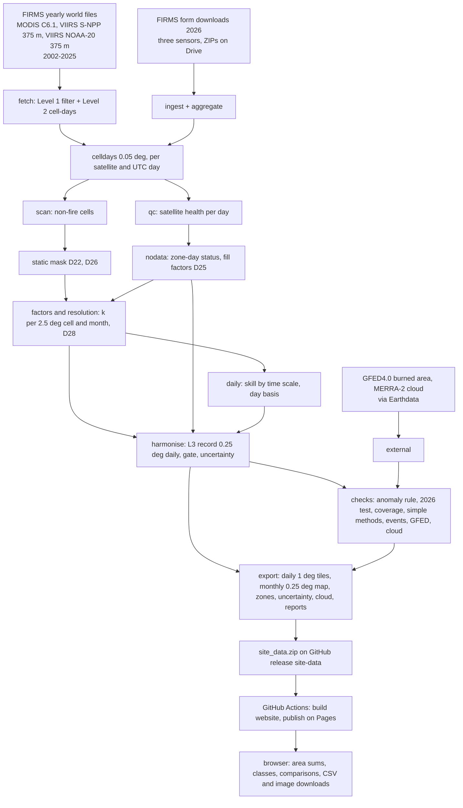

# SHIFT reproducibility guide

Audit of 8 November 2026. How to regenerate the harmonised record and the website, and what is and is not pinned. Stage-by-stage commands are in `docs/RUNBOOK.md` and `docs/COLAB_GUIDE.md`. This guide adds the audit's inventory.

## 1. Scientific code inventory

| File | Role | Key functions (line) |
| --- | --- | --- |
| `config/settings.yaml` | Every threshold, rule and year range. Rules that decide anything were committed before the run they judge | filters 57, confidence 69, record 74, counts 111, factors 214, nodata 273, resolution 356, harmonise 489, checks 426 |
| `pipeline/shift/fetch.py` | Downloads FIRMS yearly world files (`<prefix>_<year>_all_countries.zip`) | `zip_url` 43 |
| `pipeline/shift/adapters/firms_csv.py` | FIRMS CSV to Level 1 columns, confidence mapping | `_to_l1` 82 |
| `pipeline/shift/ingest.py` | Filters, counted by reason. Exact-duplicate removal | `apply_filters` 29 |
| `pipeline/shift/aggregate.py`, `grid.py` | Level 2 cell-days (0.05°) | `to_celldays` 24, `cell_index` 12 |
| `pipeline/shift/scan.py`, `static_mask.py` | Non-fire cells from FIRMS `type` | `masked_cells` 35 |
| `pipeline/shift/qc.py`, `coverage.py` | Daily satellite health | |
| `pipeline/shift/nodata.py` | Zone-day status, fill tests and fill factors (D25) | `run_nodata` 361 |
| `pipeline/shift/factors.py` | Monthly cubes, ratio estimator with shrinkage, bootstrap | `Cube` 156, `Cube.fit` 192, `bootstrap` 280 |
| `pipeline/shift/resolution.py` | Factor resolution test (D28), version and region tests, the production model | `k_variant` 59, `model_spec` 180, `k_model` 198 |
| `pipeline/shift/selection.py` | Baseline, classes, scores | `baseline` 94, `classify` 105, `score` 110 |
| `pipeline/shift/daily.py` | Skill by time scale, UTC against local day | `run_daily` 79 |
| `pipeline/shift/external.py` | GFED4.0 burned area, MERRA-2 cloud | `gfed` 117 |
| `pipeline/shift/harmonise.py` | The record (L3), gate, uncertainty, D29 guard | `d29_guard` 169, `harmonise_month` 219, `uncertainty_table` 362, `run_harmonise` 426, gate 557 |
| `pipeline/shift/checks.py` | Phase 2 checks | `anomaly_check` 118, `final_test` 184, `coverage_check` 258, `simple_methods` 363, `event_check` 410, `critical_periods` 544, `gfed_check` 677, `cloud_check` 733 |
| `pipeline/shift/export.py` | Website files | `pack_daily` 68, `cloud_flags` 107, `run_export` 133 |
| `web/src/lib/` | Browser-side sums, classes, comparisons, downloads | `data.js` `areaSeries` 142, `analysis.js` `monthly` 21, `compareWindow` 93, `season` 137 |
| `validation/audit_site_data.py` | Audit checks on the published data | A1-A6 |

## 2. Data flow

## 3. Versions

| Component | Pinned how | Version of the 7 November record and export |
| --- | --- | --- |
| Python | Colab default | 3.13.18 (export provenance) |
| pandas | `pipeline/requirements.txt` `>=2.2,<3.1` | 2.2.3 |
| numpy | `>=1.26,<2.6` | 2.4.6 |
| pyarrow, PyYAML, shapely | ranges in `requirements.txt` | not stamped |
| CI | three sets: Colab-exact, oldest allowed, newest allowed | `.github/workflows/tests.yml` |
| Website | exact versions in `web/package.json` and `package-lock.json` | react 18.3.1, maplibre-gl 4.7.1, vite 5.4.11, world-atlas 2.0.2, topojson-client 3.1.0 |
| Code | git commit in every report's provenance stamp | record and checks built on commits of 7 Nov, export on `0f95990` |
| Settings | SHA-256 of `settings.yaml` in every report | export: `ab498fb5...` |

## 4. Parameters that decide results

| Parameter | Value | Where | Basis |
| --- | --- | --- | --- |
| Grid | 0.05° | settings `grid` | D4, matches v1 |
| Confidence kept | nominal, high (MODIS low below 30, high from 80) | settings 64-72 | MODIS C6 user guide convention, D24 rule |
| FRP accepted | 0 to 50,000 MW | settings `filters` | plausibility |
| Fire type kept | 0 only | settings `filters` | FIRMS `type` |
| Static mask | labelled in at least 2 years, all years (D22), flare tiles (D26) | settings `static_mask`, `nonfire` | rules before the run |
| Calibration reference | S-NPP | settings `factors.reference` | D3, D8 |
| MODIS pieces | merged Terra+Aqua to 2019, Aqua alone from 2020 | settings `counts.source_segments` | D19 rule |
| Fit years, merged piece | 2012-2019 | `report_resolution.json` version test | MF3 rule |
| Factor cell | 2.5°, parent 10°, world | settings `resolution.fine_deg`, `factors.tile_deg` | D28 rule |
| Shrinkage prior | 30 hotspots, 300 MW | settings `factors.prior_cells`, `prior_frp_mw` | chosen by hand, not estimated |
| Minimum for own monthly factor | 30 hotspots, 300 MW | settings `factors.min_cells_per_month`, `min_frp_mw_per_month` | by hand |
| Bootstrap | 200 samples, seed 26 | settings `factors` | |
| Calibrated range bins | under 30, 30-300, over 300 predicted hotspots a month | settings `phase2_checks.coverage` | rule before the run |
| Gate | ±5%, 2009-2011 against 2013-2015 | settings `harmonise.gate` | rule before the run |
| Fill rule | method must beat scaling by 1 point, global error within ±5%, month error limit 25% | settings `nodata.rule` | rule before the run |
| D29 | D19 fill off from 2023-02-01 | settings `harmonise.d19_fill_off_from` | D29 |
| Day basis | UTC | `daily/day_basis.json` | rule before the run |
| Anomaly classes | z of log(1+x): -1, 1, 2; spread floor 0.05; at least 5 years | `selection.py` `classify`, `web/src/lib/analysis.js` | convention |
| Comparable start | 2003-01-01 | settings `record` | D20 |

## 5. Constants in code without a settings entry (hidden assumptions)

| Constant | Value | File | Effect |
| --- | --- | --- | --- |
| Website area grid | 1° cells, centre inside the area | `web/src/lib/area.js` | area edges |
| Maximum daily tiles per area | 40 | `web/src/lib/data.js` `MAX_TILES` | Russia refused |
| No-data zone size | 30° | settings `nodata.zone_deg`, export | coarse availability |
| Season definition | 31-day smoothing, 10% and 90% of cumulative fire from the quietest day | `analysis.js` `season` | descriptive, not tested |
| Window comparison | up to 366 days, years with any no-data day dropped | `analysis.js` `compareWindow` | |
| Cloud flag for an area | factor cells with at least half the area's fire flagged | `analysis.js` `cloudMonths` | |
| Area uncertainty | fire-weighted mean of cell ranges (fully correlated) | `analysis.js` `areaRange` | conservative |
| Export source code per 1° cell-day | maximum of the 0.25° rows combined | `export.py` line 161 | a mixed cell-day shows as filled |
| Calendar colour bins | area's own non-zero days at 40, 65, 82, 93, 98% | `web/src/components/Calendar.jsx` | display only |

## 6. Input and output schemas

- Level 1 detections and Level 2 cell-days: `pipeline/shift/contract.py` (`L1_COLUMNS`, `L2_COLUMNS`) and `docs/DATA_CONTRACT.md`.
- Level 3 record: `l3/year=YYYY/month=MM/part.parquet` with `date, cell25, lat, lon, cells_h, frp_h, n_raw, src` (`harmonise.py` line 469). `src` codes in `SOURCES` (line 61).
- Website files: described at the top of `pipeline/shift/export.py` (binary layouts of `daily/<tile>.bin.gz`, `monthly/<YYYY-MM>.bin.gz`, `zones.bin.gz`, and the JSON files).

## 7. Provenance

Every stage report carries `provenance`: git commit, whether code or settings differed from that commit, settings SHA-256, dataset, Python, numpy and pandas versions, UTC run time. The 2026 test result is locked in `checks/` and shown, never recomputed (`allow_rerun: false`).

## 8. Regenerating the record

Full rebuild (Colab, account with access to the Drive folder):

1. Setup cell from `docs/COLAB_GUIDE.md` section 2 (clones the repo, links Drive, runs the tests).
2. Stages in the order of `docs/RUNBOOK.md`: fetch, ingest and aggregate (2026 ZIPs), scan, qc, confscan and confidence, nodata, places, factors, resolution, daily, external (Earthdata login in Colab Secrets), harmonise, checks, export.
3. Upload `site_data.zip` to the GitHub release `site-data`. The Pages workflow builds and publishes.

What will differ on a rebuild: FIRMS may reprocess archive files. The 2026 part comes from form downloads dated about 30 October 2026, which are not public files. The checks stage shows the stored 2026 test rather than rerunning it.

Website only (anyone): `cd web && npm ci && npm run get-data && npm run dev`.

## 9. Tests

- `pipeline/tests/`: 64 tests on synthetic worlds with known answers (63 passed and 1 skipped where `h5py` is missing). `python -m pytest -q` in `pipeline/`.
- `validation/test_audit_site_data.py`: tests of the audit statistics. `python -m pytest -q validation`.
- Both run on GitHub Actions on every push.

## 10. Validation script

`validation/audit_site_data.py` recomputes the continuity and integrity checks from the public site data (VALIDATION_REPORT section 8). Results of 8 November 2026 are in `validation/results/`.
